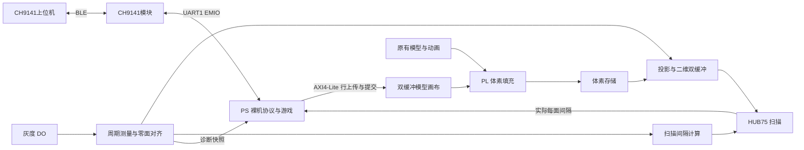

# FPGA_DISPLAY：PYNQ-Z2 FPGA 体积显示器

**GitHub 源码仓库说明：** 本仓库保留项目源码、工程配置、上位机、测试、构建脚本与开发文档。按上传要求，不包含比赛RAR/解压副本、Vivado/Vitis缓存或BIT/XSA/ELF/BOOT等编译产物。下文镜像路径和校验值是本地交付记录；从GitHub克隆后请按[源码重建说明](docs/source-checkout.md)生成产物。

基于 Zynq-7000 和旋转 HUB75 屏幕的体积显示项目，从原 STM32 工程移植。PL 负责体素、投影、屏幕扫描和灰度同步，PS 裸机程序负责蓝牙协议、画笔和游戏，上位机通过 CH9141 BLE 操控。

**交接更新时间：2026-11-03。接手的 AI 请先读 [AI_HANDOFF.md](AI_HANDOFF.md)，再按任务阅读源码。**

## 当前状态与用户要求

| 功能 | 当前状态 |
|---|---|
| 原有静态/动画显示 | 已实现，用户此前确认能正常显示 |
| 蓝牙画笔 | 已移植，用户确认显示和画笔使用正常 |
| 贪吃蛇 | 已实现并通过主机/RTL相关回归；用户此前明确尚未烧录验收，应尽量保护其现有行为 |
| 3D 俄罗斯方块 | 已实现并构建；通过软件与接口回归，尚无实机效果验收记录 |
| 灰度测速、自动调整每面间隔 | 已修复并生成配套镜像；125 MHz 原始脉冲仿真通过，最新修复镜像尚无实机验收记录 |
| TF 数据存储/读取、体素文件上传播放 | 尚未完成业务移植；SD0 和 xilffs 支持已准备，不等于功能可用 |

**最新交付：画笔笔迹/光标及贪吃蛇蛇头/蛇身/食物已缩小到显示约 3×3×3（每轴实际 2～3 个体素）。已重新综合、实现、构建应用和 BOOT，尚未烧录验收。测速链保持不变，支持用户反馈的 960 RPM。**

960 RPM = **16 转/秒**，当前每转 **120 面**，对应约 **1920 面/秒**。灰度一圈周期为 62.5 ms，处于现有测速和扫描范围内；按当前整数分频公式，每面为 **65088 个 125 MHz 时钟 = 520.704 μs**。稳定后回传应接近 `RPM:960 DLY:520`，并显示 `SYNC:TRACK`。

源码中的 `TARGET_RPS=15` 是标称/失锁自由显示参考值。有有效灰度输入时按实测周期跟随，**不需要为 960 RPM 将其改为 16**。960 的结论来自现有公式核对；此前原始脉冲仿真覆盖的是 540、900、1320 RPM，不能将其写成已完成 960 RPM 实机验证。电机由外部驱动器控制，本工程不调电机 PWM。

## 使用入口与最新镜像

| 项目 | 当前入口 |
|---|---|
| 工程根目录 | `C:/Users/1569/Desktop/test` |
| Vivado 工程 / BD / 顶层 | [test.xpr](test.xpr) / `design_1` / `design_1_wrapper` |
| 最新交付目录 | [migration/2026-11-03-small-voxels](migration/2026-11-03-small-voxels/README.md) |
| 最新 QSPI 启动镜像 | [BOOT.bin](migration/2026-11-03-small-voxels/hardware/BOOT.bin)，偏移 `0x00000000` |
| 配套硬件 | `hardware/vx_display_small.bit`、`hardware/vx_display_small.xsa`（均在上述交付目录） |
| Vitis 平台 / 应用 | `vitis_workspace/vx_display_small` / `vitis_workspace/vx_brush_small` |
| 上位机 | 根目录 [start_ch9141.cmd](start_ch9141.cmd)，或 `python ch9141_upper.py` |

最新 BOOT 为 **4273712 字节**，桥 ID 为 **VXB4 / 0x56584234**，SHA256：

```text
70011dff210114672cbc419277ec4b603d839181377da65fe7e8aeced14e2692
```

根目录还存在历史 `BOOT.bin`、`system_wrapper.*` 等文件，**不要根据文件名推断它们是最新版本**。新 BIT、XSA、平台、ELF 必须配套，详细记录见最新目录的 [manifest.json](migration/2026-11-03-small-voxels/hardware/manifest.json)。烧录和复位应取得用户对相应操作的授权。

上位机需要带 tkinter 的 Python 3.10+ 及 `requirements_ch9141.txt` 中的依赖。完整接线、配对和操作见 [CH9141上位机说明.md](CH9141上位机说明.md)。

## 操作

上电默认原显示。**BTN2：原显示 → 画笔 → 贪吃蛇 → 3D 方块 → 原显示**；BTN3 返回原显示并复位 PL 显示状态。原显示中 BTN0/BTN1 切换内容；拨码开关用于屏幕水平/垂直翻转。

| 模式 | 上位机常用操作 |
|---|---|
| 画笔 | B 进入；W/S/A/D 移动；Shift+W/S 升降；P 落笔/抬笔；K 换色；C 清空；`[` / `]` 切换视角；E 返回 |
| 贪吃蛇 | G 进入；N 重开；A/D 左右转；W/S 控制立体转向；E 返回；每两次圈事件移动一步，稳定 960 RPM 时约 8 步/秒 |
| 3D 方块 | T 进入；N 重开；P 暂停；W/S/A/D 平移；↓ 软降；空格硬降；Q/Z、R/F、C/V 分别控制 X/Y/Z 轴正反旋转；E/Esc 返回 |

LED3 表示 PS 画布模式，LED2 在蛇模式亮（画笔/方块均灭，以 `MODE` 区分）。LED1 拉长显示真实灰度触发；LED0 表示完整周期有效且已锁定。高转速时 LED1 可能看起来常亮，不宜仅凭肉眼判定脉冲频率。

## 硬件与通信

| 项目 | 配置 |
|---|---|
| 板卡 / 器件 | PYNQ-Z2 / `xc7z020clg400-1` |
| 工具版本 | Vivado / Vitis **2026.1** |
| PS | Cortex-A9 核0，Standalone 裸机；当前不是 FreeRTOS 工程 |
| 时钟 | PL 外部 125 MHz；PS 输入 50 MHz；CPU 650 MHz；DDR 525 MHz |
| 屏幕 / 数据 | 128×64 HUB75；PS 模型画布 32×32×24；PL 体素空间 128×128×64；RGB111 |
| 灰度传感器 | 数字输出 DO → **PMODB pin7 / V16**，3.3 V 逻辑，共地；一圈一个标记 |
| 蓝牙模块 | CH9141，UART **115200、8N1、无流控、透传** |
| 板端 UART1 TX | **PMODB pin9 / V12 → 模块 RXD** |
| 板端 UART1 RX | **PMODB pin10 / W13 ← 模块 TXD** |
| UART0 | 板载 USB 调试串口，MIO14..15，115200 8N1；此前电脑端为 COM16，重新连接时需重新枚举 |
| SD0 / QSPI | 已启用；SD0 使用 MIO40..45。TF 文件业务尚待开发 |

电源按模块实物规格接入；模块允许 5 V 供电不代表 FPGA 的串口/传感器信号可用 5 V。HUB75 全部引脚以 [test.xdc](test.srcs/constrs_1/new/test.xdc) 为准。屏幕具体驱动芯片尚不清楚，PL 队友负责屏幕硬件，现有驱动已能显示。

CH9141 使用 BLE `FFF0` 服务、`FFF1` 通知、`FFF2` 写入；配对码 `0000` 由 Windows 配对窗口输入，上位机不直接发送 PIN。BLE 操控无需选择 COM 口。USB UART0 用于日志，蓝牙控制命令走 UART1；启动横幅不是控制命令。

## 软件与 PL 结构



| 路径 | 用途 |
|---|---|
| [test.srcs/sources_1/new/test.v](test.srcs/sources_1/new/test.v) | `test_panel`，模式、按键、填充/投影调度、灰度同步及诊断 |
| `test.srcs/sources_1/new/{index_sync,rev_timing,panel_scan}.v` | 灰度测量、按圈分频、实际屏幕扫描 |
| `test.srcs/sources_1/new/{brush_axi,vol_fill,voxel_mem,proj_engine,frame_buf}.v` | PS/PL 画布桥、体素填充/存储、投影和屏幕帧缓存 |
| [software/brush_app/main.c](software/brush_app/main.c) | PS 启动、UART、轮询、游戏时钟、模式协调与状态回传 |
| `software/brush_app/vx_brush.c/.h` | 画笔、模式与兼容行协议 |
| `software/brush_app/vx_snake.c/.h` | 贪吃蛇逻辑，后续开发优先保持稳定 |
| `software/brush_app/vx_tetris.c/.h` | 6×6×10 的 3D 方块逻辑和体素渲染 |
| `software/brush_app/vx_upload.c/.h` | 不可变快照、768 行增量上传、提交及超时处理 |
| `software/brush_app/vx_sync.c/.h` | 测速快照、RPM/实际扫描间隔换算与 `SYNC` 状态 |
| `software/brush_app/vx_hardware.h` | 从配套 XSA 生成的地址和硬件摘要，不应手工猜写 |
| `ch9141_upper.py` / `ch9141_ble.py` | Tk 界面 / BLE 后台传输 |
| `scripts/` / `tests/` | 参数生成、平台/镜像脚本、主机和 RTL 回归 |
| `migration/` / `docs/` | 按日期保留的交付、证据和开发日志 |

## 状态判读与验证

`STATUS` 行提供 `RPM`、`DLY`、`MODE` 及模式专属信息；每秒的 `SYNC` 行提供实际同步状态。`DLY` 是整数微秒，例如 960 RPM 时显示 520，精确分频结果为 520.704 μs。`F/S` 是历史兼容占位字段，不能据此判断当前 PL 同步状态。

| SYNC | 含义 |
|---|---|
| `TRACK` | 周期有效，实际扫描面间隔符合每圈120面的整数取整要求 |
| `ADJUST` | 已测到新周期，扫描间隔还在切换 |
| `ACQUIRE` | 已收到首个脉冲，等待下一圈 |
| `LOST` | 灰度失锁；测速为0，显示按默认15转/秒自由运行 |
| `LIMIT` | 测速有效，但扫描时序达到硬件限值 |

当前测量保留 36 ms 拒绝窗口和 500 ms 超时；不是任意手动慢转都能建立有效转速。零面能对齐也不等于已锁定测速，需同时查看 RPM 与 SYNC。

缩小前基线验证包括540/900/1320 RPM原始输入连续变速、实际面间隔、整面更新、失锁重锁、12项上位机测试及原三模式3000步完整画面差分一致。本次缩小后画笔/蛇/方块/测速主机回归通过；画面尺寸已主动改变，不再声称与旧版完整画面差分一致。本次未改RTL、未重跑RTL仿真。最新构建内部时序 WNS +0.071 ns、WHS +0.012 ns。仍有既有外部 I/O 延时约束警告，不能据此声称完成屏幕板外时序验收。

已有产物可这样复查（不烧录硬件）：

```powershell
cd C:\Users\1569\Desktop\test
python scripts/verify_small_delivery.py
python scripts/create_small_boot.py --verify-only
```

测试、构建流程、寄存器和历史问题详见 [AI_HANDOFF.md](AI_HANDOFF.md) 及 [灰度测速与显示同步修复日志](docs/rotation-sync.md)。文档交接本身不需要重新综合或编译。

## 参考与交接文件

- 原工程：`C:/Users/1569/Desktop/vx-display/VX-Display-main`，实际 MCU/上位机代码在其 `vx-display/` 子目录；作为只读参考。根目录 `upper_computer_original/` 为原上位机参考副本。
- 板卡资料：`C:/Users/1569/Desktop/vx-display/PYNQ-Z2.pdf`。
- [画笔移植记录](docs/brush-port.md)、[贪吃蛇日志](migration/2026-11-01-snake/贪吃蛇移植日志.md)、[3D方块日志](migration/2026-11-02-tetris/3D俄罗斯方块开发日志.md)、[最新灰度同步日志](docs/rotation-sync.md)。历史日志中的旧模式数、桥 ID 和镜像路径应按其日期理解。
- `.gitignore` 忽略大部分生成目录、BIT/XSA/ELF/BOOT、测试输出和迁移证据。仅克隆 Git 不一定包含烧录产物和差分基线；交接时应另行保留所需 `migration/` 产物及其 manifest。部分早先已跟踪的生成文件可能仍显示在 Git 状态中，不要为清理状态擅自删除或回退它们。
