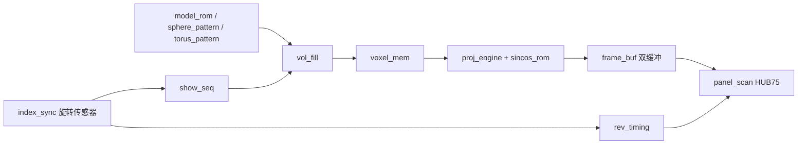

# VX 体积显示器：工程对接与 PS 外设迁移日志

日期：2026-10-31（Asia/Shanghai）。工具原生日志可能使用宿主机时区。

用户补充：现有 PL 已在实物上验证可正常驱动屏幕，屏幕型号与 PL 设计由队友负责。此次不修改显示 RTL；未向用户要求额外屏幕资料。工具发现的时序/约束问题如实记录，交给 PL 队友对接，不以猜测的外部延时覆盖现有约束。

## 任务与范围

用户授权在当前工程配置蓝牙 UART、板载 TF 卡，完成综合、实现、bitstream、含 bit 的 XSA 导出，并创建 Vitis 平台。用户已确认蓝牙采用 PMODB 9/10。本轮交付是硬件与软件平台基础；完整蓝牙协议、文件收发、画笔、贪吃蛇应用尚未移植，也没有上板验证。

- 当前工程根目录：`C:/Users/1569/Desktop/test`，项目 `test.xpr`。
- 参考根目录：`C:/Users/1569/Desktop/vx-display/VX-Display-main`，只读。
- 板卡资料：`C:/Users/1569/Desktop/vx-display/PYNQ-Z2.pdf`（31 页）。提取全文在 `evidence/PYNQ-Z2-manual.txt`。
- 器件：`xc7z020clg400-1`；顶层：`design_1_wrapper`；有效 BD：`design_1`。
- 工程里还保留 `system`、`test_ps` 等历史 BD/XSA，不能混作本次硬件。
- Vivado 与 Vitis 均为本机 2026.1，PS 为 Zynq-7000 Cortex-A9。
- 原有工作区存在大量未提交修改；没有执行 checkout/reset Git，也没有提交或清理用户文件。
- 修改前 `test.xpr`、`design_1.bd`、`test.xdc`、旧 XSA 已保存到 `baseline/`；已有 tracked 源码差异保存在 `baseline/preexisting-changes.patch`。

## 当前 FPGA 代码理解

有效数据链路：

| 模块 | 代码中的实际职责 |
|---|---|
| `test.v / test_panel` | 板上开关/按键消抖、填充调度、投影与帧交换、LED 状态；125 MHz |
| `voxel_mem.v` | 128×128×64，RGB 各 1 bit，8 色；每个 `(z,y)` 行 128 bit；地址 `{z[5:0],y[6:0]}`，bit x 对应 x；三个颜色平面 |
| `vol_fill.v` | 唯一体素写入者；六拍图案流水延迟；全体素遍历约 8.9 ms |
| `model_rom.v` | 内置鸡、9 帧行走人物、单帧 DNA；将 PL 坐标映射回 32×32×24 模型 |
| `sphere_pattern.v` | 球壳，青色；与原工程 Fibonacci 粒子球并非同一算法 |
| `torus_pattern.v` | 红色环面，查表平方/平方根与六拍流水，随帧改变半径 |
| `show_seq.v` | 实际为球、环面、鸡、人物、DNA 五项；人物/环面逐圈换帧；每项 90 圈 |
| `proj_engine.v` | 旋转平面采样体素，生成 128×64 平面，坐标计算使用流水乘法 |
| `frame_buf.v` | 两帧 128×64×3，显示/写入分离，支持垂直翻转 |
| `panel_scan.v` | HUB75 RGB 双半屏、32 行扫描、移位/锁存/OE，支持镜像与列偏移 |
| `index_sync.v` | 异步传感器两级同步、稳态过滤、最小脉冲间隔、周期有效性、丢脉冲回退 |
| `rev_timing.v` | 迭代除法计算 `hold_max = period/6400 - 840`，每圈调整扫描时间 |

实际 `ONE_ITEM=0`，每圈 200 相位，`PACE_MAX=0`。注释中仍有“单项测试”“一项一秒”等历史文字，应以代码常量为准。

PS 当前未通过 AXI 接入体素存储，`PCW_USE_M_AXI_GP0=0`；没有新增虚构的 AXI 地址或中断 ID。仅启用 UART/SD 不能使 PS 更新显示。

## 参考单片机工程理解

参考项目有 STM32H743 主显示器与 STM32F407 遥控底板。本次主要复用 `vx-display/Core/user_code` 的主显示器协议和业务算法；`DAC+OLED+PWM(SDIO和TIM)` 是遥控/底板工程。

- 原蓝牙模块 README 标为 E104-BT52，主显示器 UART4 配置为 **115200、8N1，无硬件流控**。当前实物型号尚未核验，不自动发送 AT 指令或改模块参数。
- `main.c` 的 UART 空闲 DMA 回调分发交互命令，主循环执行 `BT_PollVoxelReady/BT_PollCommands/BT_PollSaveFile`，阻塞 SD 文件操作应保留在主循环/任务上下文。
- `bt_commands.c/.h`：`:STATUS`、`:LIST`、`:LOAD <filename>`、`:DATA <size>`、`:SAVE <filename> <size>`；`:DATA/:SAVE` 后有二进制数据，移植后必须使用明确的接收状态机处理分包、粘包、长度上限、超时，不能用 UART 空闲间隔作为包边界。
- `brush_mode.c/.h`：32×32×24 画布、2×2×2 笔刷、六色、光标闪烁；`:BRUSH` 激活，`JL/JR/JU/JD` 移动，`JB0/JB1` 改变移动轴，`JP` 切换画/移，`JK` 切色（在 main 分发），`:CLEAR` 清屏，`JE` 退出。保留相对视角坐标的逻辑。
- `snake_game.c/.h`：32×32×24，六向转向查表、2 格步长/2×2×2 单元、最多 200 节、穿墙、撞自己死亡、红色食物/绿色身体/黄色头；`JG` 开局，`JL/JR/JU/JD` 转向，`JE` 退出；原为每 2 个霍尔周期走一步。
- `sd_animation.c/.h`：VXAN 16 字节头、32×32×24、每帧 24576 个调色板索引。不能仅凭 `.bin` 扩展名判定格式，须检查 magic/尺寸/帧数和文件长度。
- `slice_player/anim_player/anim_player_v2/anim_player_v3` 是针对 WS2812 的预计算切片播放器；V2 0x03 是 50 片 1 bit，V3 0x04 是 50 片 6 bit、64 色调色板。原系统为 100 相位（50 正向加 50 反向），不是当前 PL 的 200 相位。
- STM32 的 HAL、DMA、TIM、DWT、`.RAM_AXI/.RAM_D1` 内存段、BSRR 编码和 `__RBIT` 输出方式不可直接复制到 Cortex-A9/HUB75。

## PS/PL 分工与下一阶段接口

建议第一版使用单核 Standalone：PS 处理 UART 接收、协议状态机、FatFS、模型解析、画笔与蛇逻辑；PL 保留旋转同步、投影、HUB75 时序。先以主循环轮询实现外设联调，再按实测需要引入 UART 中断或 FreeRTOS，不假设 SMP。

下一阶段需实现并验证（本轮未实现）：

1. 增加 PS `M_AXI_GP0`、AXI 互连/复位/时钟及体素写入桥；为体素行组织 12 个 32-bit 数据寄存器（R/G/B 各 128 bit）与行地址、提交、忙/错误状态。
2. 在 `vol_fill` 与 PS 写入之间建立明确的所有权切换、忙等待和提交边界，避免后台自动轮播覆盖画笔/游戏内容。跨时钟使用握手或异步 FIFO，不能直接跨域传总线。
3. 从真实 XSA/BSP 取得分配地址；先小区域写入、再全屏更新；考虑逐帧可见性。当前 96 个 BRAM36 仅用于体素，完整第二份体素缓冲不能直接假定放得下。
4. 优先移植 VXAN 体素格式，使用与 `model_rom` 一致的坐标映射。当前 PL 每色只有 1 bit，原 64 色和亮度调节需要明确量化方案；若要完全复刻色彩则需重新评估存储与扫描结构。
5. 原 `.slices` 属于显示设备相关输出格式；需转换或增加独立切片输入链路，不能当作体素文件直接加载。
6. 蓝牙先验证 `:STATUS` 和短命令，再做 TF `:LIST/:LOAD`，最后实现有确认/限速/超时的二进制传输；UART1 不使用 STM32 UART DMA API。

## 本次硬件修改

| 用途 | PS 配置与实际接线 |
|---|---|
| USB 调试 | UART0，MIO14 RX、MIO15 TX，板载 FTDI |
| 蓝牙 | UART1，EMIO，`bt_uart_tx` → V12 / PMODB9 → 模块 RX；模块 TX → W13 / PMODB10 → `bt_uart_rx` |
| TF | SD0，MIO40..45，4-bit；CD=MIO47；WP 禁用；SDIO 外设目标 50 MHz |
| DDR/启动信号 | 原 PS7 DDR、FIXED_IO 原未引出，现已接至顶层标准接口 |

蓝牙信号采用 LVCMOS33，RX 上拉；需共地、3.3 V 逻辑，电源按模块实物规格连接。PMODA 全部已用于屏；PMODB1..4 用于屏、7 用于传感器，9/10 在原约束中空闲，用户已同意采用。UART1 波特率由应用 `XUartPs_SetBaudRate(...,115200)` 设置，不能声称仅凭硬件已完成串口软件初始化。

新增 XDC 仅两条 UART 管脚约束；既有 HUB75、125 MHz 时钟、传感器和按键约束保留。未修改任何显示 RTL。

使用官方 Vivado MCP 修改有效 BD 并生成 wrapper。PS 参数通过技能 `ipcfg::require/capture` 分两次写入；最终 `REQ:OK 11/11`，配置写入阶段无 ERROR/CRITICAL WARNING/被忽略参数，证据为 `evidence/ps-enable.tcldict`、`evidence/ps-route.tcldict`。`hardware/design_1.tcl` 为修改后 BD 重建脚本，使用前须先加入 `test_panel` 的 RTL 源文件。

板卡手册第 14、17、24 页核实 SD、USB UART、PMOD 接线。未安装新的板卡仓库。原 DDR 型号/频率/PCB 延迟沿用当前工程：16 bit、512 MB 地址范围、`MT41K256M16 RE-125`，实际 DDR 时钟约 516.67 MHz；训练使能。板级延迟仍是原工程数值（DQS-to-clock 0.0，board delay 0.25）。TUL 预设下载失败，未用其他开发板预设替代；DDR 稳定性仍需后续上板内存测试与板级 preset 核对。

## 阅读中发现的原有问题

- `index_sync.v:192` 使用 `25'd62499999` 表示 500 ms，但 25 位只能表示到 33554431，常量截断后为 28945567；125 MHz 下约 231.565 ms。综合确实报告 `Synth 8-10929`。修复应同时将 `TMO_RUN`、`idle`、`tmo` 及相关常量宽度扩大为至少 26 位。本轮不改变显示时序，保留为待修复项。
- 体素写端与投影读端可能同时访问同一地址，原模块已说明读写碰撞现象；新交互功能不能假定帧原子更新。
- 当前显示 RTL 中有大量历史说明与实际参数不一致，后续应先核对代码再调参。

## 构建与平台结果

首次综合通过（0 ERROR、0 CRITICAL WARNING）；首次实现成功生成 bitstream，但内部 setup 未通过。路由器估计 WNS=-0.494 ns；时序报告重新分析值应以 `evidence/timing-initial/timing.rpt` 为准。路径为 `u_proj` DSP 到 `xy_tab`，保持时间通过。未将此版本作为最终硬件导出。

已保留第一次的 routed DCP、完整运行日志、时序报告、合并约束、方法学 JSON，在 `evidence/timing-initial/`。第二次采用本机枚举确认存在的 `Performance_ExplorePostRoutePhysOpt` 实现策略，保持 RTL 与真实 8 ns 时钟约束不变。方法学有 25 项 TIMING-18（缺失外部 I/O 延时）；未添加猜测值或豁免。完整板级时序仍需要屏幕器件/外部路径时序资料。

第二次实现完成并通过内部时序检查，保持显示 RTL 不变：

| 检查 | 最终结果 |
|---|---|
| `synth_1` | `synth_design Complete!`，0 ERROR、0 CRITICAL WARNING |
| `impl_1` | `write_bitstream Complete!` |
| setup | WNS **+0.011 ns**，TNS 0，失败端点 0 |
| hold | WHS **+0.045 ns**，THS 0，失败端点 0 |
| pulse width | WPWS +3.020 ns，失败端点 0 |
| DRC | 0 ERROR / CRITICAL；保留 10 个优化建议警告：DPIP-1×4、DPOP-1×2、PLBUFGOPT-1×4 |
| 方法学 | 仍有 25 项 TIMING-18，未豁免，外部接口完整性验证留给 PL 队友 |
| 资源 | LUT 3942 (7.41%)，寄存器 6311 (5.93%)，BRAM 113.5/140 (81.07%)，DSP 2/220 |
| 硬件导出 | `hardware/vx_display_ps.xsa`，包含 bitstream |
| 独立 bit | `hardware/vx_display_ps.bit`，4045771 字节 |
| 交付校验 | XSA 的 9 项 UART/SD 关键参数全部匹配；内含 bit 与独立 bit 逐字节一致 |

最终报告：`evidence/final-timing.rpt`、`final-drc.rpt`、`final-methodology.json`、`final-utilization.rpt`；构建原日志：`final-synthesis.log`、`final-implementation.log`；交付 SHA256：`hardware-verification.json`。内部 setup 裕量很小，但已按原 8 ns 约束完成分析；没有放宽周期或加路径豁免。

Vitis 平台已创建并构建成功，官方 API `platform.build()` 返回 SUCCESS（数值 0）：

| 项目 | 实际结果 |
|---|---|
| workspace | `C:/Users/1569/Desktop/test/vitis_workspace` |
| 平台 | `vx_display_ps` |
| 应用域 | `standalone_ps7_cortexa9_0`，Standalone，`ps7_cortexa9_0` |
| 启动域 | `zynq_fsbl`，同样使用 core 0 |
| 平台文件 | `vitis_workspace/vx_display_ps/export/vx_display_ps/vx_display_ps.xpfm` |
| 库 | 应用域已构建并导出 `libxil.a`、`libxilffs.a`、Standalone/timer 库 |
| FatFS | SD 接口，`FILE_SYSTEM_USE_LFN=1`，支持原 `.slices` 等长文件名；静态工作缓冲适用于当前单线程方案 |
| 调试输入/输出 | `STDIN_BASEADDRESS=STDOUT_BASEADDRESS=0xe0000000`，UART0 |
| 启动 ELF | 导出 `sw/boot/fsbl.elf`，580484 字节，MCP 验证 ELF32、ARM machine=40 |
| 硬件一致性 | 平台导入 XSA、平台导出 XSA 均与本次交付 XSA 字节一致 |

实际 BSP `include/xparameters.h`：

- `XPAR_XUARTPS_NUM_INSTANCES=2`；USB `XPAR_UART0_BASEADDR=0xe0000000`；蓝牙 `XPAR_UART1_BASEADDR=0xe0001000`；UART 参考时钟 100000000 Hz。
- `XPAR_XSDPS_NUM_INSTANCES=1`；`XPAR_SDHCI0_BASEADDR=0xe0100000`，SDIO 时钟 50000000 Hz，HAS_CD=1、HAS_WP=0。
- DDR 可供应用使用的生成范围为 `0x00100000..0x1fffffff`。应继续引用实际 BSP 宏，不手写通用设备 ID。
- UART 的 `_INTERRUPTS` 宏是该版本 SDT 生成的编码值，后续中断代码必须按该版本驱动/中断包装 API 处理，不直接当作传统裸 GIC ID 使用。

平台验证证据：`evidence/vitis-platform.json`、`platform-verification.json`、`bsp-inspection.json`、`vitis-os-parameters.json`、`vitis-xilffs-parameters.json`；最终完整构建日志为 `vitis-platform-final-build.log`。`scripts/verify_vx_handoff.py` 已成功核验 XSA 参数、bit 一致性、平台 XSA 一致性、两路 UART/一路 SD、UART0 stdout、长文件名开关、BSP/导出静态库文件头及 FSBL ELF32 ARM。

创建过程曾遇到运行环境和诊断脚本问题，均已处理：

1. 沙箱拒绝 Vitis 写用户 `.Xilinx` 日志/运行目录，表现为“Error in generating Processor List”。用本机 SDTGen 只读探测确认 XSA 内有 `ps7_cortexa9_0/1` 后，保留错误证据并通过权限审核重新运行，未修改已安装工具。
2. 日志 JSON 保存遇到 protobuf `RepeatedScalarContainer`，已修正序列化；平台本体已创建，因此增加显式 `VX_PLATFORM_RESUME=1` 的安全续建模式。续建先逐字节验证平台导入 XSA 与本次 XSA 相同，再获取该组件，不删除或重建目录。
3. 官方 Windows CLI 退出后工作区锁短暂保留，等待释放后续建；未删除锁文件或终止其他用户会话。Vitis batch launcher 可能在 Python 异常时仍返回 0，因此验收依据是成功日志与真实新产物，不仅看 shell 返回码。

在 Vitis 中打开上述 workspace 即可继续创建应用，选择 `vx_display_ps` 和 `standalone_ps7_cortexa9_0`。重建脚本为 `scripts/create_vx_platform.py`；默认拒绝覆盖已有平台。仅对本次平台续建时，在启动 Vitis CLI 的进程中设置 `VX_PLATFORM_RESUME=1`。应用代码和应用 ELF 尚未创建；生成的 ELF 是平台启动用 FSBL。未更改全局 `build_enabled=false`，没有调用或绕过应用构建工具的开关。

## 实物验证与下次对接

本轮 UART 蓝牙通信、TF 卡挂载/读写、DDR 压力测试、旋转屏回归均为 **SKIPPED（未上板执行）**。用户已确认的是原 PL 显示正常，不能把它当作本次新增 PS 外设已实测的证据。

后续分工建议：PS 侧先在此平台上完成 UART1 收发和 TF 文件读写；与 PL 队友共同约定体素写入桥、显示模式所有权、提交/忙握手及旋转周期读取接口，再接入画笔/贪吃蛇。保留现有 HUB75 输出链路，优先复用原蓝牙指令及 32×32×24 的业务坐标。完整游戏复刻尚未完成，不能仅凭平台创建就宣称已移植成功。

构建授权不包含 JTAG/Flash 下载或硬件复位；本次不执行这些操作。

## 资料与实现依据

- 用户提供的 `PYNQ-Z2.pdf`，特别是第 10、14、17、24 页。
- AMD [Processing System 7 PG082](https://docs.amd.com/api/khub/documents/5SmKudM_4jpvP8OtqGslWA/content)：PS UART/SDIO 与 EMIO 能力。
- 本机 `D:/APP/2026.1/Vivado/data/ip/xilinx/processing_system7_v5_5/component.xml`、`xgui/` 与 `preset/ZedBoard.tcl` 仅用于确认同一 PS7 IP 的参数语法；未应用 ZedBoard 预设。
- Vitis 已安装官方示例 `cli/examples/embedded/platform_uc4_zynq.py`、`platform_creation_standalone.py` 和 `cli/vitis/cli_client.py`、`platform_component.py`、`domain.py`；未照搬官方示例的删除目录操作。
- Vitis-PS MCP 已核实安装版本与旧 XSA；创建平台能力未暴露为 MCP 工具，因此使用已核对的官方 2026.1 Python API，脚本 `scripts/create_vx_platform.py`。
